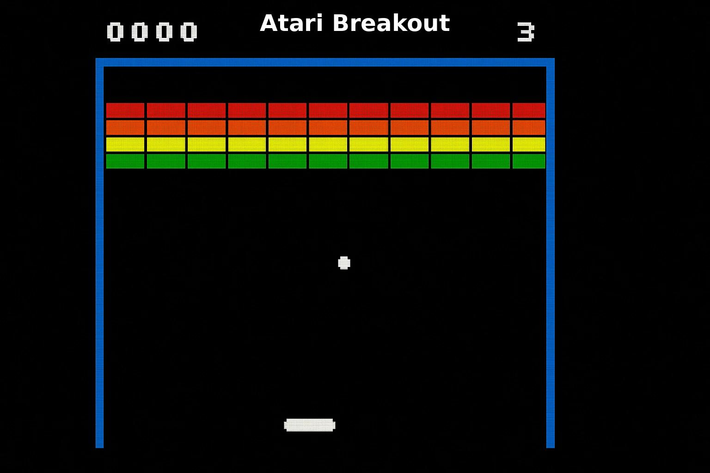

# Breakout

Recovered from [the updated conversation](https://chatgpt.com/share/6ad6802b-8b4c-83ed-b133-b493de53a773), assistant message `51905b89-f5a1-5834-92d7-6c19183543e8`. This is a reference image, not a Spheroboy screenshot. [Image source](https://onlinevgames.com/atari-breakout/); [provenance](references/manifest.json). The original host's TLS connection failed during recovery; the exact full-size image cache URL retained by the chat supplied the saved file.

## Recovered intent

The owner suggested Breakout as an initial wrist gesture game. The assistant proposed left/right tilt to move a paddle, using Pong's ball physics and display foundations, then adding bricks, scores, and levels. The owner selected the standalone screen direction for the project.

## Proposed first playable scope

One landscape monochrome playfield, one horizontal paddle at the bottom, one ball, a fixed brick grid, three lives, score, serve delay, pause, win, game-over, and restart. Propose an 8-column × 4-row grid with one hit per brick. Use the coloured screenshot as a layout reference; colour is not required on the proposed display.

Use calibrated left/right tilt-to-velocity control initially, consistent with the Pong control experiment. Neutral stops the paddle. Avoid a permanently vertical trajectory after paddle contact by varying rebound angle with impact position and enforcing a minimum horizontal component.

## Implementation needed

- Reuse Pong's timing, input filtering, rectangle rendering, paddle movement, and tested wall/paddle collision primitives.
- Add a compact grid of brick states, layout data, brick score values, and remaining-brick count.
- Resolve the earliest ball contact within a simulation interval; handle adjacent bricks and corners consistently without double scoring.
- Add bottom-boundary life loss, ball reset, serve timing, level completion, and terminal-state handling.
- Tune paddle size and ball speed for a short 64-pixel-high playfield; reserve a readable HUD area.

## Acceptance criteria

1. The paddle travels left/right within bounds and stops at calibrated neutral.
2. Each brick disappears and scores exactly once; simultaneous corner/adjacent contacts do not duplicate rewards or trap the ball.
3. At maximum supported speed, the ball cannot pass through a brick, paddle, or wall.
4. Crossing the bottom boundary removes exactly one life; the next serve resets correctly. The last life produces game-over.
5. Removing the final brick produces a win state; no continuing physics corrupts that state.
6. Pause freezes play; restart restores every brick, the initial lives/score, ball, paddle, and timers.
7. A recorded on-device session shows bricks and HUD remain readable during motion.

## Later scope and decisions

Additional layouts, multi-hit bricks, levels, sounds, and stored best scores follow the first playable. Multiball and power-ups would substantially expand collision and state handling and are outside the initial scope.

Relative game-logic effort: **moderate after Pong**. The key incremental risk is collision resolution at brick boundaries, rather than drawing the bricks. See [shared platform](shared-platform.md) and [implementation order](implementation-plan.md).
