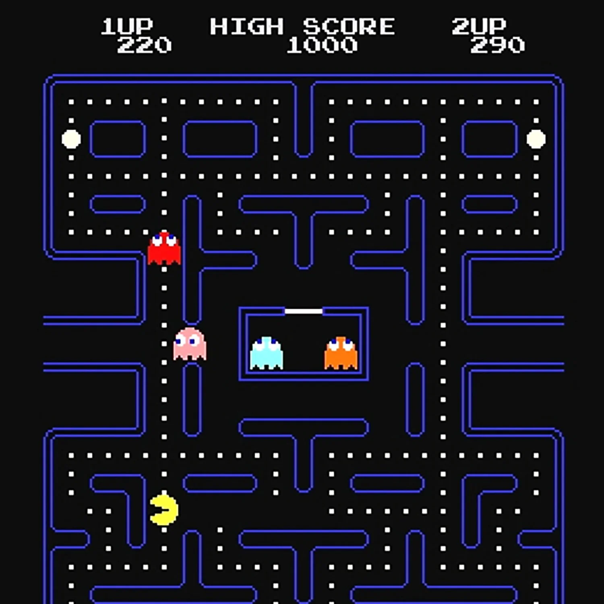

# Pac-Man

Recovered from [the updated conversation](https://chatgpt.com/share/6ad6802b-8b4c-83ed-b133-b493de53a773), assistant message `51905b89-f5a1-5834-92d7-6c19183543e8`. This illustrates the original game rather than an implemented Spheroboy screen. [Image source](https://disegnojournal.com/newsfeed/never-alone-moma-paola-antonelli-interview); [provenance](references/manifest.json).

## Recovered intent

User message `b94f6119-0ca4-4124-98da-3e77a843fbd4` asks whether Pac-Man can run on Sphero hardware. The next user request confirms the arcade game and wrist gestures. Assistant message `389d3b25-2b1e-5e2d-9229-af091a18cdf6` proposes Lua rules with C hardware drivers, four-direction tilt, start/pause, and optional sound. The owner subsequently chose a standalone wrist screen. This does not establish a requirement to reproduce the original maze or all original ghost algorithms.

## Proposed first playable scope

Build a **compact maze-chase adaptation**: one custom maze, one player, pellets, one ghost, three lives, win/game-over, pause, and restart. Additional ghosts, power pellets, frightened mode, tunnels, fruit, multiple levels, and arcade-accurate behaviour are later scope.

At 128 × 64, propose 4 × 4 pixel tiles with a 28 × 14 tile maze: 112 × 56 pixels. This leaves eight pixels of height for a small HUD and sixteen pixels of width for margins/status. Verify recognisability with an actual-size prototype before committing. A taller 28 × 31 tile maze would need 112 × 124 pixels at that scale; the 64-pixel-high display cannot show it at once. Avoid promising a full original layout on this screen.

Store walls as a grid and remaining pellets as a compact bitset. A 28 × 14 bit plane needs 49 bytes before alignment; two planes need 98 bytes. Runtime objects and Lua tables can consume much more, so keep static map data compact and measure actual heap usage.

## Controls

Convert tilt into a cardinal requested direction using thresholds, a dominant-axis rule, and hysteresis. Buffer the last requested turn and apply it at a legal tile junction. Moving characters continue along a corridor at fixed speed; neutral does not itself stop the character in the proposed first version. Reverse direction immediately when the map permits. Resolve ambiguous diagonals consistently. These are new design proposals to playtest.

## Implementation needed

- Map validation: solid boundaries, legal spawn positions, connected walkable area, and reachable pellets.
- Tile-aligned movement and wall collision, with buffered input and character interpolation for drawing.
- Pellet occupancy/counting, score, lives, respawn, win, and game-over transitions.
- One ghost choosing legal junction moves with a simple target rule; use a seeded decision source for reproducible checks. Full arcade AI is unnecessary for this milestone.
- Collision handling that also catches player/ghost swaps across the same corridor segment in one update.
- Distinct monochrome symbols for walls, pellets, player, and ghost at the chosen tile scale.

## Acceptance criteria

1. All pellets are reachable from the player spawn and neither player nor ghost crosses walls or map boundaries.
2. Early turn requests execute at the next legal junction; neutral/diagonal input does not cause rapid unintended direction changes.
3. Each pellet scores once; the final pellet produces a win.
4. Direct contact and opposite-direction position swaps both lose exactly one life. Respawn places characters safely and preserves remaining pellets; full restart restores the maze.
5. Pause/resume and game-over behave deterministically without a large catch-up step.
6. An actual-size screen review confirms the maze and characters are distinguishable; an on-device playtest confirms four-direction tilt is usable.

Relative game-logic effort: **largest of the three**. Display readability and motion-to-direction control are separate feasibility gates even if the processor has sufficient capacity. See [shared platform](shared-platform.md) and [implementation order](implementation-plan.md).
