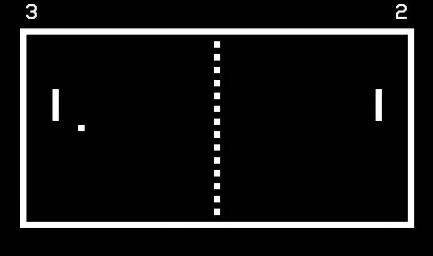

# Pong

Reference image recovered from [this conversation](https://chatgpt.com/share/6ad6802b-8b4c-83ed-b133-b493de53a773), assistant message `51905b89-f5a1-5834-92d7-6c19183543e8`. It illustrates the original game, not a working Spheroboy implementation. [Image source](https://www.metrolibre.com/tecnologia/pong-el-famoso-arcade-que-dio-pie-a-la-industria-del-videojuego-cumple-50-anos-BB3056892); [provenance](references/manifest.json).

## Recovered intent

The owner requested wrist gesture games, suggested Pong or Breakout first, and chose a screen mounted on the Force Band. The chat proposed one player against a computer opponent, up/down wrist input, Lua game logic, a monochrome OLED, speaker feedback, and button start/pause.

The chat's final control table makes neutral stop paddle movement. Therefore start with tilt-to-velocity control rather than silently replacing it with absolute position control.

## Proposed first playable scope

Landscape 128 × 64 layout, player paddle at left, opponent at right, one ball, top/bottom walls, score outside the playfield, serve delay, pause, match result, and restart. Propose first to five points and a short stationary serve countdown. Keep score and physical dimensions configurable.

Tilt on the calibrated vertical screen axis controls paddle velocity. Clamp position to the playfield. The opponent follows the ball with capped speed and reaction delay; it should be beatable rather than perfectly tracking every frame. A short button press starts or pauses; shared menu controls handle restart and exit.

## Implementation needed

- State machine: ready → serving → playing → point → serving; paused and match-over states.
- Fixed-step ball position/velocity and paddle movement, independent of drawing speed.
- Wall and paddle collision handling, position correction, and one score event per boundary crossing.
- Controlled rebound angle based on paddle impact position; enforce a minimum horizontal component to avoid endless near-vertical rallies.
- Speed limits and swept collision or bounded substeps to prevent tunnelling at the maximum supported speed.
- Small number font and visible ball/paddle dimensions on the actual screen.
- Shared input, display, menu, and calibration services from [the platform](shared-platform.md).

## Acceptance criteria

1. Calibrated neutral stops the paddle; intentional tilts move it both directions and cannot move it outside the playfield.
2. Ball rebounds from each wall/paddle, including edge impacts, at supported maximum speed without passing through or sticking.
3. A missed ball awards exactly one point, then serves correctly; reaching the target score ends the match.
4. Pause/resume preserves positions and does not advance the ball by the elapsed paused time.
5. Restart resets score, entities, serve timer, and match state; returning through the menu repeatedly does not grow memory use.
6. A recorded on-device session demonstrates a beatable opponent, readable score, and responsive motion control.

## Later scope and decisions

Add sounds, difficulty levels, saved high scores, or alternative input mapping after the first playable. Decide exact tilt range/dead zone, serve direction, paddle size, and difficulty through playtesting. Do not add a second player or networking to the initial scope.

Relative game-logic effort: **smallest of the three**. Shared hardware access, display, and runtime work remain the dominant uncertainty. See [implementation order](implementation-plan.md).
