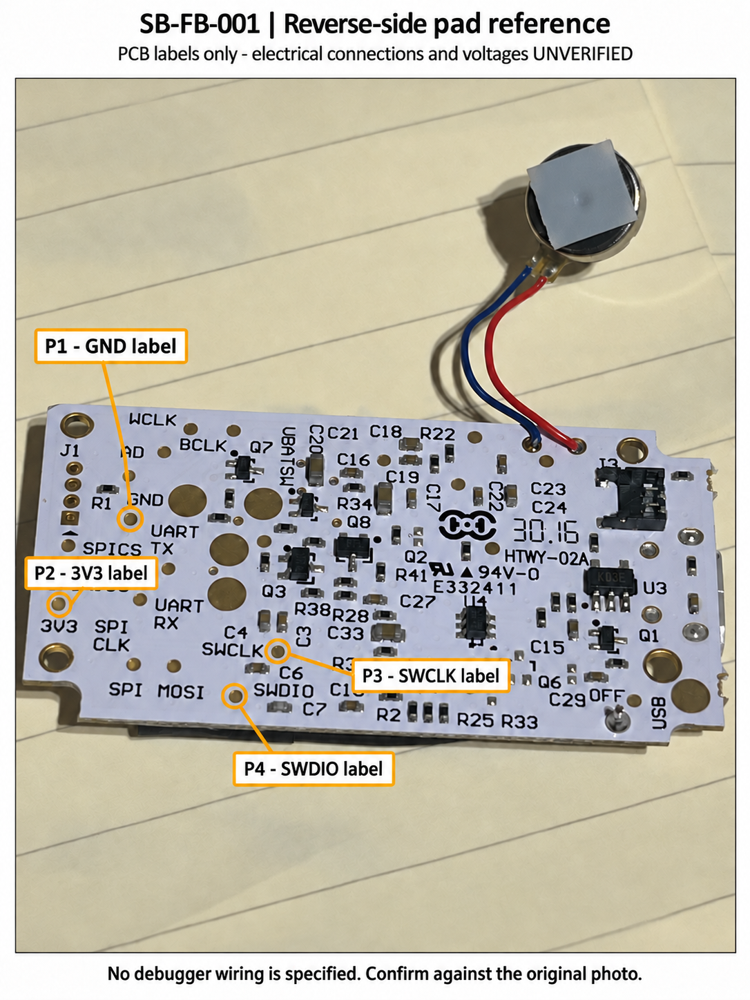

# Force Band reverse-side pad reference

Hardware: SB-FB-001. Related task: TASK-3. Date: 2026-10-19.

[Open annotated board view](annotations/force-band-reverse-pads.png).

The four markers identify small gold pads associated with readable PCB silkscreen. **Electrical functions and voltages remain unverified.** This is a visual identification aid, not a completed wiring diagram or a measurement result.

The annotation was produced with image generation and visually checked against the [untouched source photograph](photos/notion-53dd11c2f5456bccee28ca13f87c8e14c34bc024ef9bd5ba674f5568d43f3585.jpg). The source photo is authoritative for physical geometry and traces; do not infer traces or component markings from the generated image. Source and annotation hashes are recorded in the [provenance file](annotations/force-band-reverse-pads.json).

## Pad identities and pending evidence

Locations below refer to the original photo displayed upright, with the motor above the PCB and the board labels readable.

| Marker | Visible label | Small pad location in original photo | Evidence still needed |
|---|---|---|---|
| P1 | GND | Immediately below the printed `GND` label; left of a much larger round gold area | Verify against a known board ground before using as the voltage-measurement reference |
| P2 | 3V3 | Immediately above `3V3`, near the left edge; above the lower-left mounting hole | Measure the rail relative to verified ground; determine its relationship to MCU VDD before using it as a debugger voltage reference |
| P3 | SWCLK | Immediately right of `SWCLK`, above C6 | Verify its connection to the MCU SWD clock net or document supporting trace evidence and remaining uncertainty |
| P4 | SWDIO | Immediately left of `SWDIO`, near the lower board edge | Verify its connection to the MCU SWD data net or document supporting trace evidence and remaining uncertainty |

The rings refer to the small pads, not adjacent mounting holes or larger exposed round areas. The printed `3V3` is a label; it is not a measured voltage.

## Measurement record

### J1: alternate connection candidate

J1 is the four-position through-hole footprint at the left edge of the upright reverse-side photograph, below the `J1` text. Three pads are round and the lowest pad is square. The square pad conventionally indicates pin 1, but the manufacturer numbering and signal assignment are not established here. The much larger mounting hole above the `J1` text is separate.

For an unambiguous measurement record, use these **project reference labels**, not manufacturer pin numbers:

- **J1-A:** uppermost small round hole, nearest the printed `J1` label.
- **J1-B:** next small round hole down.
- **J1-C:** next small round hole down.
- **J1-D:** lowest, square pad/hole.

Four holes could accommodate a SWD connection, but this is only a hypothesis. `J1` is a connector reference, not a signal description. Determine whether it exposes the same nets as the labeled pads before selecting it for wiring.

With USB and battery disconnected, measure resistance between each J1 position and each labeled pad. Record actual resistance and the probe-lead baseline rather than relying only on a continuity beep. The multimeter setup will be specified after its model is known.

| J1 position | P1: GND label | P2: 3V3 label | P3: SWCLK label | P4: SWDIO label |
|---|---|---|---|---|
| J1-A | Not measured | Not measured | Not measured | Not measured |
| J1-B | Not measured | Not measured | Not measured | Not measured |
| J1-C | Not measured | Not measured | Not measured | Not measured |
| J1-D | Not measured | Not measured | Not measured | Not measured |

A clear near-zero connection supports a shared net; results affected by components or charging capacitors need interpretation. If no direct mapping is established, retain J1 as unidentified rather than assuming a standard four-pin pinout. Header pitch and cable compatibility also remain unmeasured.

### Pending pad measurements

| Item | Result | Power state / method |
|---|---|---|
| P1 to independently identified ground | Not measured | Exact accessible comparison point and meter setup pending |
| P2 voltage relative to verified ground | Not measured | DC-voltage measurement with normal target power; setup pending |
| P2 relationship to MCU supply | Not verified | Datasheet tracing / unpowered resistance checks pending |
| P3 to MCU SWD clock net | Not verified | Datasheet tracing / accessible unpowered checks pending |
| P4 to MCU SWD data net | Not verified | Datasheet tracing / accessible unpowered checks pending |

The MCU supply specification is 1.7–3.6 V, as recorded in [MCU and memory identification](mcu-and-memory.md). Actual board voltage and other components' voltage limits still need establishing.

The multimeter make/model and a suitable accessible ground reference are needed to prepare exact probe instructions. Continuity/resistance checks require USB and battery disconnected. Powered readings use DC-voltage mode. The Atmel-ICE and adapter connections will be specified only after their pinout, cable orientation, and target-voltage compatibility have been documented.

TASK-3 remains In Progress: the annotated candidate-pad view is available, while measured supply rails and verified instrument connections remain outstanding.
